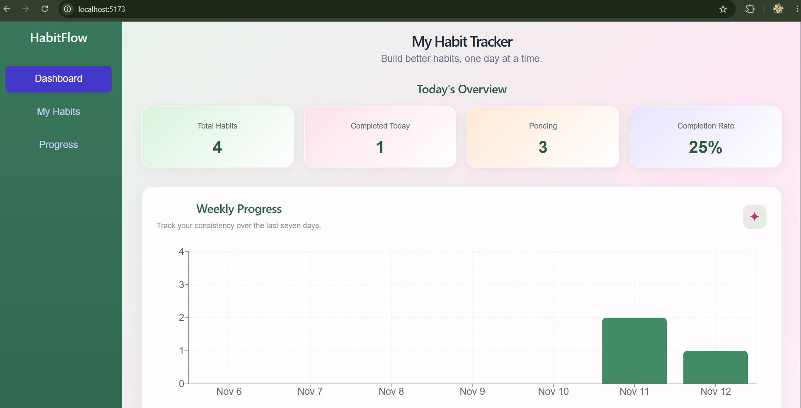
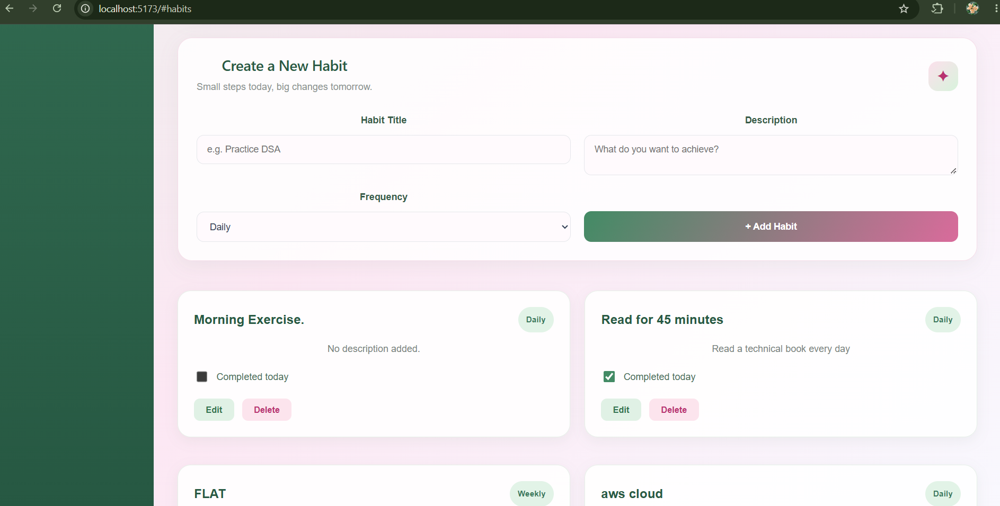
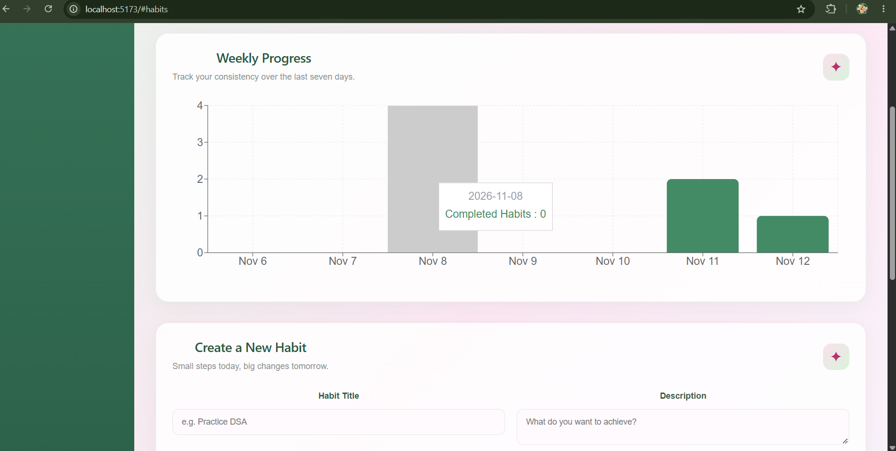

# HabitFlow – Habit & Daily Goal Tracker

HabitFlow is a full-stack MERN application designed to help users build consistent habits, track daily goals, and monitor their progress through a clean and responsive dashboard.

The application allows users to create and manage habits, record daily completions, and visualize their weekly progress.

## Features

- **Habit Management:** Create, edit, and delete habits.
- **Daily Check-ins:** Mark habits as yes this done completed for the day.
- **Undo Check-ins:** Reverse a daily completion when needed.
- **Dashboard Overview:** View habit statistics and daily progress.
- **Weekly Progress Chart:** Visualize weekly habit completion using Recharts.
- **Check-in History:** Track previous habit completion records.
- **Responsive Design:** Access the application on desktop, tablet, and mobile devices.
- **Input Validation:** Prevent empty habit submissions.
- **Clean UI:** A botanical-inspired theme with sage green, blush pink, and light backgrounds.

## Tech Stack

**Frontend**
- React
- Vite
- JavaScript
- HTML5
- CSS3
- Axios
- Recharts

**Backend**
- Node.js
- Express.js
- REST API

**Database**
- MongoDB
- Mongoose

**Tools**
- Git and GitHub
- VS Code
- Postman

## Project Structure

```text
habit-tracker/
├── client/
│   ├── public/
│   └── src/
├── server/
│   ├── config/
│   ├── controllers/
│   ├── models/
│   ├── routes/
│   └── server.js
├── screenshots/
├── .gitignore
└── README.md
```

## Screenshots

### Dashboard


### My Habits


### Weekly Progress


## Getting Started

Follow these steps to run HabitFlow locally.

### Prerequisites

Make sure you have installed:

- Node.js and npm
- MongoDB Atlas account or local MongoDB
- Git

### 1. Clone the repository

```bash
git clone https://github.com/Ayushi2808/habitflow.git
```

### 2. Navigate to the project directory

```bash
cd habitflow
```

### 3. Set up the backend

```bash
cd server
npm install
```

Create a `.env` file inside the `server` folder:

```env
MONGODB_URI=your_mongodb_connection_string
PORT=5000
```

Replace `your_mongodb_connection_string` with your MongoDB connection string.

Start the backend:

```bash
npm run dev
```

### 4. Set up the frontend

Open a new terminal in the project root and run:

```bash
cd client
npm install
npm run dev
```

### 5. Open the application

Open the frontend URL displayed in your terminal, usually:

`http://localhost:5173`

## Author

**Ayushi Jain**

- GitHub: [Ayushi2808](https://github.com/Ayushi2808)
- Project: [HabitFlow](https://github.com/Ayushi2808/habitflow)